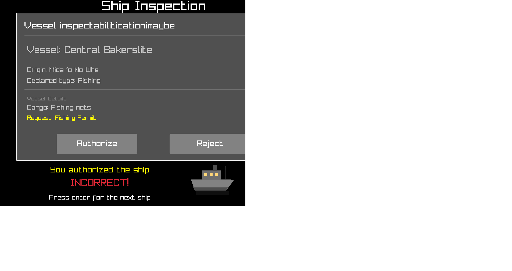

# false-voyage
False Voyage is a ship detection game where you must decide if a incoming ship is real or not. 

* Classification Entry
* Rising difficulties
* Tutorial
The game relies on your ability to remember attributes such as boat colors, origin, and type of boat it is to determine whether a ship is real or not.
The application only uses raylibs.
[Raylibs](https://www.raylib.com/)

Ship classifications:
Red - Anomaly
Blue - Fishing
White - Passenger
Gray - Cargo

Most of these ships are based off of Californian or East Coast cities.

Build:
pacman -S mingw-w64-ucrt-x86_64-raylib
C:/msys64/ucrt64/bin/g++.exe -std=c++17 src/main.cpp -o FalseVoyage.exe -lraylib -lopengl32 -lgdi32 -lwinmm 